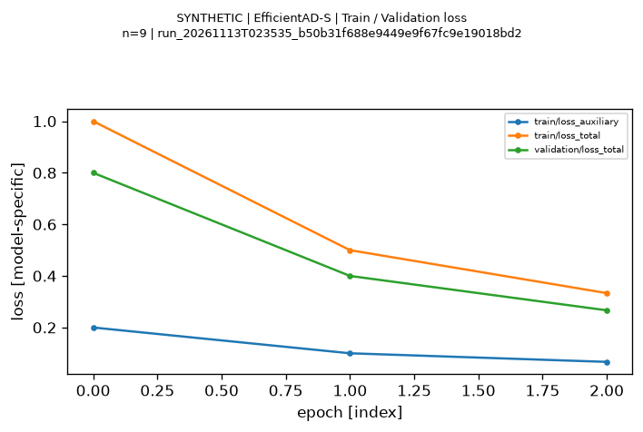
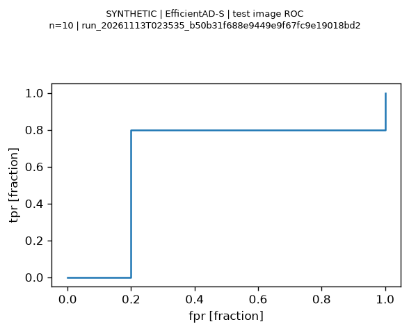
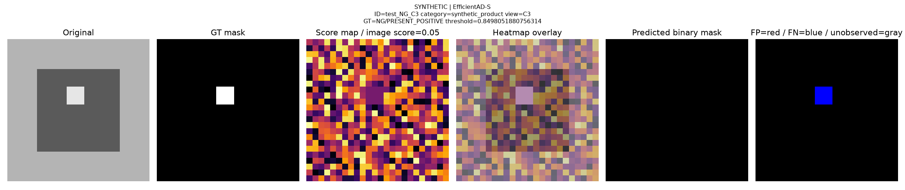

# SYNTHETIC 이상탐지 보고서 — 배포용 발췌

**실제 모델 성능이 아니다.** 원본 자동 보고서에서 주요 수치와 그림 3개만 선별했다. 나머지 그림·원시 예측·중간 Run은 배포하지 않는다. 아래 명령으로 전체 보고서를 다시 만들 수 있다.

- Run: `run_20261113T023535_b50b31f688e9449e9f67fc9e19018bd2`
- 모델 이름 필드: `EfficientAD-S` (공식 모델은 호출하지 않음)
- 상태: `PARTIAL`, `data_kind=SYNTHETIC`, 실제 학습 실행 `False`
- 입력: 합성 24×24 RGB, Validation 10장 / Test 10장, 각 Split에 선언 제품 2개·C1~C5
- CPU Benchmark 대상: `SYNTHETIC_TINY_CONV_NOT_OFFICIAL_MODEL`. 실제 모델 속도·GPU 메모리는 NOT_MEASURED

## Test 지표

| 지표 | 합성 계산값 |
|---|---:|
| Image AUROC | 0.640000000 |
| Image AP | 0.740000000 |
| Image F1 | 0.800000000 |
| Pixel AUROC (근사) | 0.777777778 |
| Pixel AP (근사) | 0.548373780 |
| Pixel F1 | 0.734693878 |
| AUPRO (근사) | 0.664726285 |

Pixel AUROC/AP는 Validation 범위를 고정한 2,048-bin 근사다. AUPRO는 8방향 연결 성분에 동일 가중치를 부여하고 256개 Threshold의 FPR 0~0.3 구간을 정규화해 적분한다. NG 미주석·빈 NG 2장은 위치 평가에서 제외하며 이미지 NG 라벨은 유지한다. 유효 픽셀은 4,608개다.

## 대표 시각화



3개 epoch의 Loss 값은 기록·그래프 생성 검증을 위해 직접 만든 숫자다. 실제 학습이나 성능 향상 증거가 아니다.



이미지 단위 GT와 이상 점수로 계산한 ROC다. 이 표본의 AUROC는 0.64이며 실제 EfficientAD-S의 성능이 아니다.



의도적으로 결함 점수를 낮춘 C3 사례다. GT·이상 히트맵·Overlay·이진 예측·FN 위치를 같은 원본 좌표에서 비교한다. Real-IAD 원본 이미지는 포함하지 않았다.

## 재현 및 사용 범위

MV 루트에서 실행한다. 데이터셋·모델 가중치 없이 12개 모델 이름을 사용하는 합성 Run을 새 디렉터리에 생성한다. 기존 결과는 덮어쓰지 않는다.

```bash
uv run --locked python scripts/experiments/smoke_test_reporting.py
```

출력된 실제 `run_dir`를 다음 명령의 값으로 사용한다.

```bash
uv run --locked python scripts/experiments/generate_report.py --run-dir outputs/experiments/실제run_id
uv run --locked python scripts/experiments/compare_models.py --runs-root outputs/experiments/ --include-synthetic --allow-partial
```

비교 명령의 두 옵션은 합성 예제 확인용이다. 실제 결과 비교에서는 제거한다. 이 예제만으로 모델 선택·성능 순위·GPU 속도를 판단하지 않는다.

[공통 규약](../../../docs/experiments/EXPERIMENT_PROTOCOL.md) · [인프라 검증](../INFRASTRUCTURE_VALIDATION.md) · [그림 출처 및 SHA-256](ARTIFACTS.json)
