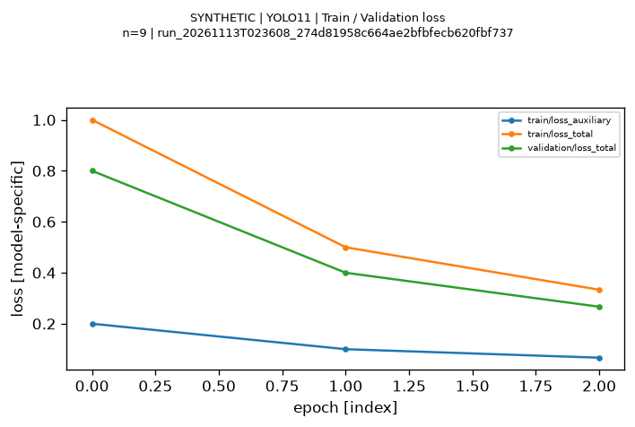
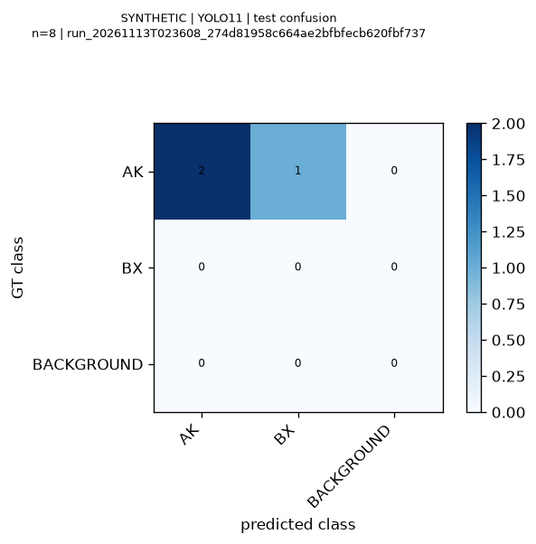
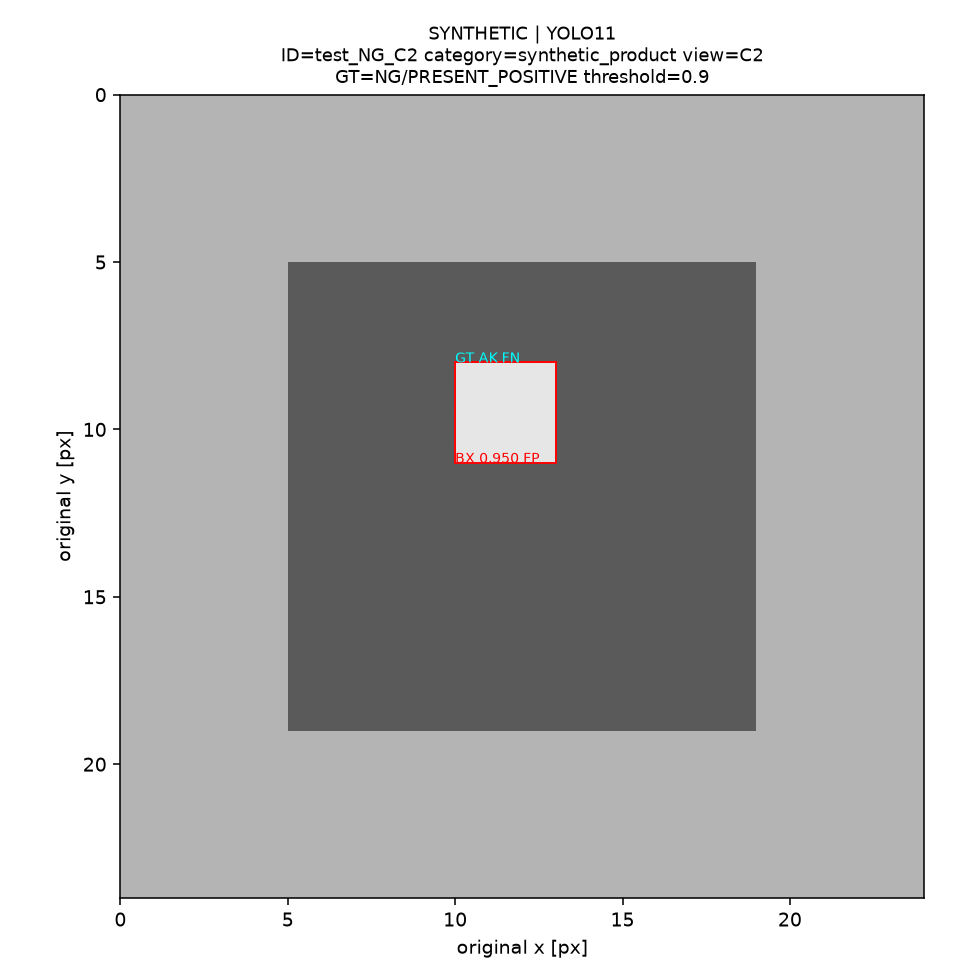

# SYNTHETIC 객체탐지 보고서 — 배포용 발췌

**실제 모델 성능이 아니다.** 원본 자동 보고서에서 주요 수치와 그림 3개만 선별했다. 나머지 그림·원시 예측·중간 Run은 배포하지 않는다. 아래 명령으로 전체 보고서를 다시 만들 수 있다.

- Run: `run_20261113T023608_274d81958c664ae2bfbfecb620fbf737`
- 모델 이름 필드: `YOLO11` (공식 모델은 호출하지 않음)
- 상태: `PARTIAL`, `data_kind=SYNTHETIC`, 실제 학습 실행 `False`
- 입력: 합성 24×24 RGB, Validation 10장 / Test 10장, 각 Split에 선언 제품 2개·C1~C5
- CPU Benchmark 대상: `SYNTHETIC_TINY_CONV_NOT_OFFICIAL_MODEL`. 실제 모델 속도·GPU 메모리는 NOT_MEASURED

## Test 지표

| 지표 | 합성 계산값 |
|---|---:|
| map50 | 0.663366337 |
| map50_95 | 0.663366337 |
| precision | 0.666666667 |
| recall | 0.666666667 |
| f1 | 0.666666667 |
| tp | 2.000000000 |
| fp | 1.000000000 |
| fn | 1.000000000 |

COCO bbox 평가의 IoU 0.50:0.05:0.95, 최대 검출 수 100, 101개 Recall 지점을 사용한다. NG 미주석·빈 NG 2장은 객체탐지 평가에서 제외한다. 정답 양성이 없는 클래스 AP는 N/A다. Confidence Threshold는 Validation에서만 고정한다.

## 대표 시각화



기록기와 그래프 검증을 위한 합성 Loss다. YOLO11 학습은 실행하지 않았다.



행은 GT, 열은 예측이다. BACKGROUND 행·열로 FP와 FN을 표시한다. 이 행렬은 클래스 무관 IoU 매칭이며, 클래스 일치가 필요한 AP/TP 집계와 구분한다.



같은 결함 위치에 다른 클래스를 예측하도록 만든 사례다. 클래스가 틀리면 정답 클래스의 FN과 예측 클래스의 FP가 발생한다. Real-IAD 원본 이미지는 포함하지 않았다.

## 재현 및 사용 범위

MV 루트에서 실행한다. 데이터셋·모델 가중치 없이 12개 모델 이름을 사용하는 합성 Run을 새 디렉터리에 생성한다. 기존 결과는 덮어쓰지 않는다.

```bash
uv run --locked python scripts/experiments/smoke_test_reporting.py
```

출력된 실제 `run_dir`를 다음 명령의 값으로 사용한다.

```bash
uv run --locked python scripts/experiments/generate_report.py --run-dir outputs/experiments/실제run_id
uv run --locked python scripts/experiments/compare_models.py --runs-root outputs/experiments/ --include-synthetic --allow-partial
```

비교 명령의 두 옵션은 합성 예제 확인용이다. 실제 결과 비교에서는 제거한다. 이 예제만으로 모델 선택·성능 순위·GPU 속도를 판단하지 않는다.

[공통 규약](../../../docs/experiments/EXPERIMENT_PROTOCOL.md) · [인프라 검증](../INFRASTRUCTURE_VALIDATION.md) · [그림 출처 및 SHA-256](ARTIFACTS.json)
